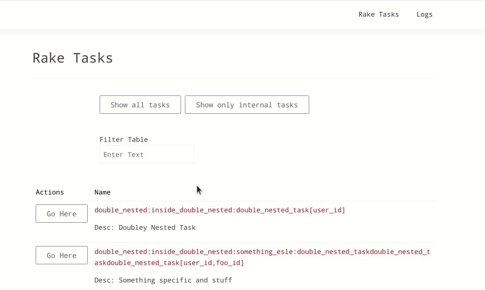

# RakeUi
Rake UI is a Rails engine that enables the discovery and execution rake tasks in a UI.



## Routes

NOTE: Relative to mountpoint in application

 - GET /rake_tasks(.html/.json) - list all available rake tasks
 - GET /rake_tasks/:id(.html/.json) - list info a single tasks
 - POST /rake_tasks/:id/execute - execute a rake task
 - GET /rake_task_logs(.html/.json) - list rake task history
 - GET /rake_task_logs/:id(.html/.json) - list a single rake task history

## Installation
Add this line to your application's Gemfile:

```ruby
gem 'rake-ui'
```

And then execute:
```bash
$ bundle
```

Or install it yourself as:
```bash
$ gem install rake-ui
```

once it is installed, mount the engine
```rb
Rails.application.routes.draw do
  # only mounting when defined will allow us only include in development/test
  if defined? RakeUi::Engine
    mount RakeUi::Engine => "/rake-ui"
  end
end
```

### Securing RakeUi

This tool is built to enable developer productivity in development.  It exposes rake tasks through a UI.

This tool will currently not work in production because we add a guard in the root controller to respond not found if the environment is development or test. You may override this guard clause with the following configuration.

```rb
RakeUi.configuration do |config|
  config.allow_production = true
end
```

We recommend adding guards in your route to ensure that the proper authentication is in place to ensure that users are authenticated so that if this were ever to be rendered in production, you would be covered.  The best way for that is [router constraints](https://guides.rubyonrails.org/routing.html#specifying-constraints)

### Log storage callbacks

By default a rake task log is written to `Rails.root/tmp/rake_ui` on the machine
that ran the task. In a multi-pod deployment another pod may serve the log page
and not have that file. These optional hooks let you point rake-ui at shared
storage:

```rb
RakeUi.configuration do |config|
  # Publish each log somewhere shared. Called with (log, event, payload) for
  # :start, :progress, :finished and :error. Progress payloads are output lines.
  config.log_writer = ->(log, event, payload = nil) { ... }

  # Return {content: "log text", finished: true/false} for a log not on this pod.
  config.log_reader = ->(log) { ... }

  # Return the ids of logs stored outside this pod, for the index page.
  config.log_list = -> { ["<log id>", ...] }

  # Write logs to a different local directory.
  config.log_directory = "/path/to/logs"
end
```

All hooks default to `nil`, so the default file-backed behavior is unchanged.
The writer runs in the forked child process, so build connections lazily after
fork. If a writer raises, the error is logged and the task keeps running. Task
output can contain secrets or personal data; only enable a writer when the
destination and its retention meet your policy.

## Testing

`bundle exec rake test`

To iterate on this fast i normally install nodemon, you can also use guard minitest.

```
# Example with nodemon, you don't have to use this
npm install -g nodemon

# Running a single test whenever models change
nodemon -w ./app/models/*  -e "rb" --exec "rake test TEST=test/rake_ui/rake_task_log_test.rb"
```

## Contributing
See [CONTRIBUTING](./CONTRIBUTING.md)

## License
The gem is available as open source under the terms of the [Apache 2.0 License](./LICENSE).
